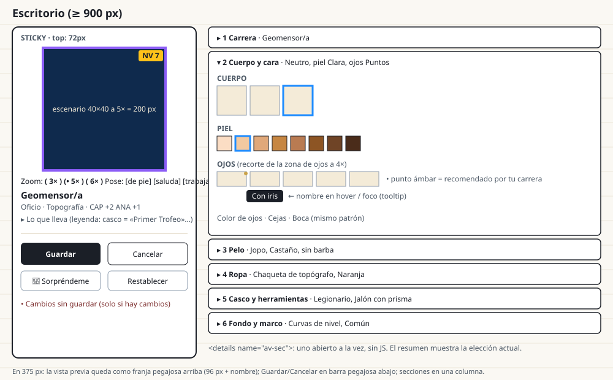
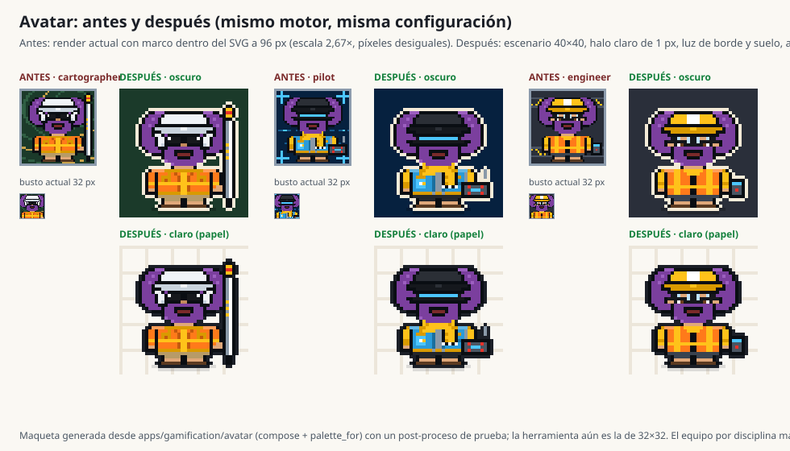

# Rediseño del avatar · editor, figura y hoja

Diseño (no código) para el pedido del dueño: «más diseño de pixel, no tan simple, que se entiendan más; simplificar
el visor donde se configura y personaliza: mucha información en la página; adaptar por sección o que se colapse».
Amplía y reemplaza el plan corto de `docs/MEJORAS_UX.md` § P1-10 (PR G). Lo que aquí cambia respecto de P1-10 se
marca con **(cambia P1-10)**.

Maquetas: [`img/avatar-editor-layout.svg`](img/avatar-editor-layout.svg) (editor, escritorio y 375 px) y
[`img/avatar-antes-despues.svg`](img/avatar-antes-despues.svg) (generada con el motor real: `compose` + `palette_for`
más un post-proceso de prueba de halo, luz de borde, suelo y escala entera).

---

## a) Hallazgos (comprobados en el código)

| # | Hallazgo | Dónde |
|---|---|---|
| H1 | El editor muestra **7 secciones con 23 grupos y 209 opciones**, todas abiertas a la vez, en una sola página | `services.SECTIONS`, `avatar_editor.html` |
| H2 | Se renderizan **139 SVG de figura completa o busto** (13 carreras + 126 miniaturas), unos **490 KB** de SVG en el HTML, más 4 de la vista previa | `services.editor_sections`, `_career_clusters` (medido con el motor) |
| H3 | Cada carrera es una tarjeta grande con figura de 72 px, título, lema y bonos: 13 tarjetas antes de llegar a la cara | `_career_clusters`, `.av-cards` |
| H4 | **Escalas no enteras en todas partes**: el marco va dentro del SVG (`pad=2` → viewBox 36), así 192 px = 5,33×, 96 = 2,67×, 64 = 1,78×, la hoja 160 = 4,44×; el busto (24 + 4 = 28) a 32 px = 1,14×; las miniaturas de busto 56/24 = 2,33×; las carreras 72/32 = 2,25×. Los píxeles salen desiguales | `engine.render_svg`, `services.preview_context`, `views._render_sheet`, `avatar_tags` |
| H5 | **Los 18 fondos son oscuros** (luminancia baja, de `#06213F` a `#4A3410`) y el contorno `K` es casi negro (`#0A0E13`): la silueta se funde con el fondo. `outfit_stands_out` (≥ 1,5:1) solo se usa en «Sorpréndeme» | `palettes.BACKGROUNDS`, `palettes.FIXED`, `engine.surprise` |
| H6 | Las herramientas están metidas en 8 columnas al costado del cuerpo (x 23..31 o 0..8) dentro del mismo 32×32: el jalón mide 4 px de ancho, el control de dron 9×5, la taza 6×7. A 64 px no se reconocen | `parts/props.py` |
| H7 | La hoja repite nivel, XP y título: chip de cabecera (`partials/player.html`), `lvlbox` del héroe y `next_goal`; la portada lo repite dos veces más (`w-lvl` en la misión y `w-prof-lv`) | `sheet.html`, `core/home.html` |
| H8 | La carrera se elige en **dos lugares**: el editor de avatar (`class`) y «Editar mi hoja» (`character_class`) | `forms.SheetForm`, `views.edit_sheet` |
| H9 | El «título» de la carrera («Mago de la Forma») usa el mismo estilo Press Start que el título de juego (`Title`): se confunden | `_preview.html` `.av-title`, `editor.css` |
| H10 | El editor no tiene **Cancelar**; «Restablecer» y «Sorpréndeme» tienen el mismo peso visual que Guardar | `avatar_editor.html` |

No se pudo abrir la captura `35.webp` del dueño (el archivo ya no está en disco); el diagnóstico sale del código y de
la descripción («una sola página muy larga»).

---

## b) Decisiones de diseño (resumen)

1. **Editor en dos columnas**: vista previa grande y pegajosa a la izquierda, **6 secciones en acordeón** a la derecha,
   **una abierta a la vez** con `<details name="av-sec">` (sin JS). Los 23 grupos y las 209 opciones siguen todos ahí,
   pero solo se ve una sección.
2. **Miniaturas por zona**, no figuras completas: la opción de ojos muestra solo los ojos a 4×, la de ropa el torso a
   2×, etc. El nombre aparece al pasar el cursor o con foco. Colores como muestras de 24 px.
3. **Escala siempre entera**: el marco sale del SVG y pasa a CSS. Nuevas vistas con tamaño fijo en celdas (`stage` 40,
   `full` 32, `bust` 24, `head` 16, `zone:*`); `svg_sized` rechaza tamaños que no sean múltiplos.
4. **Silueta legible**: halo exterior de 1 px (crema en fondos oscuros, tinta en claros) y luz de borde de 1 px,
   ambos **calculados por el motor**, no dibujados. Se agregan **6 fondos claros** al final de la paleta.
5. **Escenario 40×40**: el 32×32 de siempre centrado, más un carril para equipo grande, aire arriba (antena, dron) y
   suelo con sombra. Equipo por disciplina redibujado y nuevo en `parts/gear/`.
6. **Hoja con un lugar por dato**: nivel, XP, título y próximo logro en una sola tarjeta resumen; lo demás plegado.
   La carrera se elige solo en el editor; su epíteto se llama **Lema del oficio** **(cambia P1-10: «Oficio»)**.
7. Todo sigue **saliendo de datos y siendo determinista**: misma configuración → mismo SVG, byte a byte.

---

## c) Editor `/perfil/avatar/`



### c.1 Estructura

```
<form id="avForm" class="av-editor">           (grid: 320px | 1fr ; ≤ 900 px: una columna)
  <aside class="av-stage">                      (position: sticky; top: var(--header-h))
     vista previa  ·  zoom  ·  pose  ·  tarjeta de oficio corta  ·  «Lo que lleva» (details)
     barra de acciones: [Guardar] [Cancelar]  ·  [Sorpréndeme] [Restablecer]
  </aside>
  <div class="av-sections">
     <details name="av-sec" open> <summary>1 Carrera · Geomensor/a</summary> … </details>
     <details name="av-sec"> <summary>2 Cuerpo y cara · Neutro, piel Clara, ojos Puntos</summary> … </details>
     … 6 en total
  </div>
</form>
```

- **Una abierta a la vez:** atributo `name` en `<details>` (acordeón exclusivo nativo). En navegadores sin soporte se
  pueden abrir varias: aceptable, sigue funcionando. Sin JS todo se envía igual: los radios están en el DOM aunque la
  sección esté cerrada.
- **Qué sección se abre:** `?seccion=<slug>` (servidor marca `open`); por defecto `carrera` si la persona nunca guardó,
  si no `cuerpo-cara`. Tras guardar se vuelve a la misma sección (`seccion` va en un `<input type="hidden">` que el JS
  actualiza al abrir otra; sin JS se vuelve a la por defecto).
- **Resumen en el `<summary>`:** la elección actual en texto («Jopo, Castaño, sin barba»), calculado en el servidor
  (`services.section_summary`). Con JS se actualiza al cambiar una opción.
- **375 px:** la vista previa se vuelve una franja pegajosa arriba (figura `stage` a 2× = 80 px + nombre del oficio +
  zoom oculto); la barra de acciones pasa a una barra pegajosa abajo (`position: sticky; bottom: 0`) con Guardar y
  Cancelar; Sorpréndeme y Restablecer quedan como enlaces secundarios bajo la barra. Secciones en una columna; grillas
  de miniaturas de 48 px con 6 por fila.

### c.2 Las 6 secciones (de 7 secciones / 23 grupos a 6 secciones / 23 subgrupos)

Nada se borra del catálogo: cada clave de `engine.CHOICES` sigue teniendo todas sus opciones como radio en el HTML.

| Sección (slug) | Subgrupos (opciones hoy) | Cómo se muestra |
|---|---|---|
| 1 **Carrera** (`carrera`) | `class` (13) | Selector compacto: chips de 1 línea agrupados por las 6 disciplinas (cabeza `head` 16×16 a 2× = 32 px + nombre). La actual resaltada con borde `--level` y check. Debajo, un `<details>` «¿Qué trae cada carrera?» con tabla: oficio, lema, ropa/herramienta/fondo, bonos. **Sin figura completa por carrera** |
| 2 **Cuerpo y cara** (`cuerpo-cara`) | `body` (3) · `skin` (8) · `eyes` (5) + `eye_color` (5) · `brows` (5) · `mouth` (6) | Cuerpo: busto 24 a 2×. Piel y color de ojos: muestras. Ojos, cejas, boca: recorte de la zona a 4× |
| 3 **Pelo** (`pelo`) | `hair` (17) + `hair_color` (12) · `facial_hair` (8) | Cabeza 16×16 a 3× = 48 px; color como fila de muestras justo bajo el peinado |
| 4 **Ropa** (`ropa`) | `outfit` (17) + `outfit_color` (17) · `neckwear` (5) · `pin` (4) · `legwear` (3) + `pants_color` (8) | Torso 24×12 a 2×; piernas 12×8 a 4×; colores como muestras |
| 5 **Casco y herramientas** (`casco-herramientas`) | `headwear` (13) + `headwear_color` (10) · `glasses` (9) + `glasses_color` (5) · `prop` (13 → ~20) | Cabeza a 3×; herramienta: recorte del carril de equipo del escenario a 2× |
| 6 **Fondo y marco** (`fondo-marco`) | `background` (18 → 24) · `frame` (5) · `pose` (3, nueva, también en la vista previa) | Fondo: muestra 12×12 con su dibujo a 4×; marco: muestra con borde de rareza y nombre visible (es corto) |

Cada «forma + color» se une en un subgrupo (ejemplo: «Peinado» y su color), así la persona ve juntos los dos radios
que cambian lo mismo. Sigue habiendo un `<fieldset>` por clave (accesible y probado).

### c.3 Opciones

- **Miniatura** de 48 px (o 48×24) en un botón de 52 px con borde; sin texto visible. El nombre:
  - va en un `<span class="av-tip">` que aparece con `:hover` y `:focus-within` (CSS puro);
  - está siempre disponible para lectores de pantalla (el `<label>` contiene el texto, oculto visualmente);
  - el nombre de la opción elegida se ve en la leyenda del subgrupo («Peinado: **Jopo**»).
- **Colores:** muestras de 24×24 con área táctil de 32 (padding), borde 1 px `--ink`; nombre en tooltip.
- **Recomendado por tu carrera:** punto ámbar de 6 px en la esquina superior derecha + una sola línea por sección
  «• recomendado por tu carrera». Se quita la estrella en texto y el aviso por grupo. Se mantiene el orden (recomendado
  primero).
- **Bloqueado:** candado de 8×8 en la esquina, opacidad 0,55, `disabled`; el tooltip y `aria-describedby` dicen «Se
  desbloquea con «Primer Trofeo»» o «en NV 5».
- **Seleccionado:** borde 2 px `--level` + sombra de 2 px; igual en claro y oscuro.

### c.4 Vista previa (columna fija)

- Figura `stage` (40×40) a **5× = 200 px** en escritorio. Zoom con 3 radios `name="zoom"` que **no se envían**
  (`form="none"` o fuera del form) y solo cambian la clase CSS: 3× = 120, 5× = 200, 6× = 240. Un único SVG; el ancho
  lo da CSS en múltiplos de 40 y `image-rendering: pixelated`.
- **Pose:** 3 radios `name="pose"` (de pie, saluda, trabaja) que sí se guardan (clave nueva `pose`, ver d.5).
- **Marco y nivel:** borde CSS de 4 px con `var(--rarity-*)` según `frame`; placa «NV 7» en la esquina inferior
  izquierda (HTML, Press Start 2P 10 px, fondo `--amber`). El nivel **no** entra al SVG (no es parte de la
  configuración y el SVG sigue siendo función pura de ella).
- **Tarjeta de oficio corta:** nombre de la carrera (Archivo 800), disciplina y bonos en una línea mono. El lema y la
  descripción van en «¿Qué trae cada carrera?».
- **«Lo que lleva»** (`<details>` cerrado): leyenda generada (`services.wearing(cfg, person)`):
  «Casco de obra · insignia *Primer Trofeo*», «Marco épico · insignia *Reliquia Bentley*», «Pin teodolito · NV 10»,
  «Jalón con prisma · de tu oficio».
- Se quitan las figuras de 96, 64 y 32 px («a distintos tamaños»). Se deja solo la cabeza de cabecera (32 px) a la
  derecha del nombre, para ver cómo queda en el chip.

### c.5 Acciones

| Botón | Peso | Qué hace |
|---|---|---|
| **Guardar** | primario | POST (igual que hoy) y vuelve a la misma sección |
| **Cancelar** | secundario | Enlace a la hoja (`gamification:my_sheet`) sin guardar |
| Sorpréndeme | terciario (enlace con dado) | `?azar=1`, vista previa sin guardar (igual que hoy) |
| Restablecer | terciario | `?restablecer=1`, vista previa sin guardar |

«Cambios sin guardar» aparece en la columna fija si `unsaved` (servidor) o, con JS, al primer cambio.

### c.6 JS (solo mejora)

`editor.js` sigue marcando el look de la carrera. Se agrega: actualizar el texto del `<summary>` al cambiar, guardar
la sección abierta en el campo oculto, cerrar las otras en navegadores sin `details[name]`, y el aviso de cambios sin
guardar. Sin `beforeunload` (molesta).

### c.7 Peso de la página

Hoy ~490 KB de SVG. Meta: **≤ 120 KB de HTML total** con los recortes (una zona de ojos son ~72 celdas, no 1024) y sin
figura por carrera. Prueba de tamaño (ver f).

---

## d) Figura: especificación de legibilidad

### d.1 Grillas, vistas y tamaños (todas enteras)

| Vista | Celdas | Origen (en coordenadas del escenario) | Tamaños válidos | Uso |
|---|---|---|---|---|
| `stage` (nueva) | 40×40 | 0,0 | 80, 120, 160, 200, 240 | Editor, hoja, galería |
| `full` (se mantiene) | 32×32 | 4,5 | 64, 96, 128 | Compatibilidad (directorio, tarjetas) |
| `bust` | 24×24 | 8,7 (= 4,2 del 32×32 de hoy) | 48, 72, 96 | Foro, notas, equipo, miniatura de cuerpo |
| `head` (nueva) | 16×16 | 12,8 | 32, 48 | Chip de cabecera, carreras, peinados y gorros |
| `zone:eyes` | 12×6 | 14,14 | 48×24 | Ojos, cejas |
| `zone:mouth` | 12×4 | 14,18 | 48×16 | Boca, barba |
| `zone:torso` | 24×12 | 8,23 | 48×24 | Ropa, cuello, pin |
| `zone:legs` | 12×8 | 14,32 | 48×32 | Parte de abajo |
| `zone:gear` | 16×24 | 24,0 | 32×48 | Herramientas |

- El **marco sale del SVG** **(confirma P1-10)**: `render_svg(frame=...)` deja de pintar los 4 rectángulos y de
  agregar `pad`. El marco es `class="av-frame av-frame--rare"` en el contenedor HTML (`avatar_tags`) con borde
  `var(--rarity-rare)`. El fondo sí sigue en el SVG.
- `services.svg_sized(cfg, size, view=...)` valida `size % celdas == 0`; si no, en `DEBUG` lanza `ValueError` y en
  producción redondea hacia abajo al múltiplo válido y registra un aviso (sin datos personales).
- Se cambian los tamaños en plantillas: cabecera ``, portada ``
  (hoy 64 con marco), hoja `stage` 160, editor `stage` 200.

### d.2 Silueta y luz (calculadas, deterministas)

Post-proceso en `engine.compose_stage(cfg)`, después de pintar todas las capas:

1. **Halo exterior de 1 px:** toda celda transparente vecina (4 vecinos) de una celda de la figura o del equipo toma
   la clave nueva `5` (halo). Color: si la luminancia del fondo < 0,18 → `#F4EBD8` (crema, igual a `--paper` del estilo
   doodle); si no → `#1B1F27` (tinta). Prueba: contraste halo/fondo ≥ 3:1 en los 24 fondos.
2. **Luz de borde de 1 px:** celdas de pelo, gorro, ropa, piel y pantalón cuyo vecino de arriba o de la izquierda
   está vacío pasan a su tono claro: `H→h` (ya existe), `T→3`, `O→2`, `S→1`, `P→4`. Los tonos claros se calculan en
   `palette_for` con `_lighten(hex, 0.28)`; no hay que tocar las paletas de datos.
3. **Contorno interior:** `K` sigue `#0A0E13`. Se agrega `k` = `#2B2F36` para líneas interiores finas que las piezas
   nuevas pueden usar (pliegues, cierre del chaleco) sin oscurecer todo.
4. **Suelo:** sombra elíptica de 20×2 en y 37..38 con `#000` al 20 % en fondos oscuros y `#1B1F27` al 13 % en claros.
   Fondos con dibujo: el dibujo no se pinta bajo el halo (se recorta con la máscara de la figura + 1).

`art.COLOR_KEYS` suma: `1` piel luz, `2` ropa luz, `3` gorro luz, `4` pantalón luz, `5` halo, `k` línea interior.
Ninguna pieza de `parts/` escribe `1..5` a mano (prueba: solo el motor las usa).

### d.3 Paletas

- `BACKGROUNDS`: **solo se agregan al final** (las configuraciones guardadas y `careers.py` usan índices):
  | Índice | Nombre | Base | Dibujo |
  |---|---|---|---|
  | 18 | Papel cuadriculado | `#FAF8F3` | rejilla cada 8 celdas `#ECE6DA` |
  | 19 | Plano claro | `#F1F6FC` | rejilla `#C9DDF2` + cota azul |
  | 20 | Papel kraft | `#E9DCC0` | sin dibujo |
  | 21 | Cielo de faena | `#CFE6F7` | nube 2 tonos |
  | 22 | Hormigón | `#D9D9D4` | moteado `_hash` |
  | 23 | Arena de terreno | `#EBD9B4` | curvas de nivel suaves |
- `careers.py`: a la paleta de fondos de cada carrera se le agrega **un** fondo claro afín (arquitectura → 19,
  topografía → 23, civil → 22, captura → 21, mecánica → 22, transversal → 18). El `look` por defecto **no cambia**
  (pregunta abierta Q3).
- `OUTFIT_COLORS` con poco contraste contra fondos claros (Blanco, Beige, Amarillo hi-vis) quedan legibles por el halo
  de tinta; `outfit_stands_out` se aplica también al elegir a mano y en `apply_career`: si falla, aviso en la vista
  previa («La ropa se pierde con este fondo») y no se bloquea nada.
- `FIXED` suma: `I` acero claro `#C9D3DD` (equipo), `V` pantalla `#7FE3FF` (laptop, tablet, controlador), `X` cono
  `#FF7A1A` con `x` `#FFFFFF` (franjas). Se respetan los 12 colores máximos por zona de `sprite-8bit`.

### d.4 Equipo por disciplina (`parts/gear/`)

Formato nuevo en coordenadas del **escenario 40×40**. Cada pieza: `{"rows": {y: "40 caracteres"}, "lane":
"right"|"left"|"ground"|"air", "hand": (x, y)}`. El carril derecho es x 28..39; el izquierdo x 0..11; aire y 0..6;
suelo y 33..39. Ninguna pieza dibuja en la ventana de la cara (`FACE_X`/`FACE_Y` desplazados al escenario).

| Archivo | Ids (nuevo / redibujado) | Mínimo legible |
|---|---|---|
| `parts/gear/__init__.py` | Registro `GEAR`, contrato en el docstring, `shift_legacy(rows)` para usar un prop viejo de 32×32 en el escenario | — |
| `parts/gear/survey.py` | `prism_pole` (v2: jalón de 2 px con franjas rojo/blanco, prisma 4×4 con brillo), `gnss_rover` (v2: antena 6×3 + controlador en la mano), **`total_station`** (estación sobre trípode al pie, 10×18), **`level_staff`** (mira con números de 1 px) | 6×10 celdas |
| `parts/gear/capture.py` | `drone_controller` (v2: control 9×6 con 2 palancas y pantalla `V`, **dron 8×4 en el aire**), `laser_scanner` (v2 sobre trípode, cabezal con láser `Q`), `camera` (v2) | 6×10 |
| `parts/gear/build.py` | `tablet` (v2 con cubo BIM), **`laptop_bim`** (laptop abierta 10×7 con cubo isométrico), `plans_roll` (v2), `scale_ruler` (v2), `clipboard` (v2), `calculator` (v2), **`traffic_cone`** (cono 6×8 al pie), `mug` (v2) | 6×8 |
| `parts/gear/plant.py` | `wrench` (v2), **`pipe_spool`** (tramo de cañería con 2 bridas, 12×5, al hombro), **`valve_wheel`** (volante de válvula 7×7) | 6×8 |
| `parts/gear/ai.py` | **`laptop_ai`** (laptop con grafo de nodos `C`/`V`) | 6×8 |

- `props.PROPS` y `LABELS_PROPS` **no se borran**: el motor usa `GEAR[id]` si existe y si no `shift_legacy(PROPS[id])`.
  Los ids nuevos se agregan a `LABELS_PROPS` y a `PROPS` (con `{}` como versión 32×32: en la vista `full` no se ven,
  en `stage` sí). `CHOICES["prop"]` pasa de 13 a 19.
- `careers.py` suma los nuevos a la lista `props` de cada carrera: topografía `total_station`, `level_staff`; captura
  sin cambios (el dron va con el controlador); civil `traffic_cone`; arquitectura y BIM `laptop_bim`; IA `laptop_ai`;
  mecánica `pipe_spool`, `valve_wheel`.
- En `head` y `bust` el equipo alto (jalón, antena, mira) **asoma por el hombro** porque está en el carril derecho y
  dentro del recorte (prueba: `prism_pole` cambia el SVG `bust`).

### d.5 Poses (`parts/poses.py`)

`POSES = {"stand": {}, "wave": {...}, "work": {...}}`: parches de brazos sobre `body.BASE` (en coordenadas del
32×32) y un `hand` por pose para anclar el equipo. `wave` levanta el brazo izquierdo; `work` adelanta el derecho y el
equipo se dibuja en `hand`. Clave nueva `pose` en `DEFAULTS` («stand») y `CHOICES`. Animación de reposo: se mantiene
`av-idle` (2 px a pasos, apagada con `reduce`).

### d.6 Insignias y nivel como accesorios

- **Nivel:** placa HTML «NV n» sobre el marco (c.4), no en el SVG.
- **Marco de rareza:** CSS (d.1).
- **Pines** (ya existen, por nivel) y piezas por insignia (`UNLOCKS`): se mantienen y se explican con la **leyenda
  «Lo que lleva»** en el editor y en la hoja.
- Parche de manga con el color de la insignia de mayor rareza: idea (g, n.º 4), no entra en esta ronda.

### d.7 Determinismo y datos

- `render_svg(cfg, view)` sigue siendo función pura de `clean_config(cfg)`: sin nivel, sin fecha, sin azar.
- Halo, luz, suelo y recortes se calculan; ninguna pieza nueva se dibuja «a mano» en SVG.
- `audit.py` y `tools/audit_avatar.py` recorren también `gear × pose` (equipo sobre la cara, equipo fuera del carril,
  píxeles sueltos).
- `tools/preview_avatar.py` acepta `view=stage|head|zone:<n>` y `--sheet prop` en escenario.
- Riesgo: subir a 40×40 cambia el aspecto de todos los avatares guardados (no su configuración). Se compara antes y
  después con `audit.py` y la galería.



---

## e) Hoja de personaje `/perfil/` y `/equipo/<id>/`

### e.1 Un lugar por dato

| Dato | Único lugar en la hoja | Se quita de |
|---|---|---|
| Nivel, barra y XP («faltan N») | Tarjeta resumen (derecha del héroe) | — (el chip de cabecera queda como navegación global: solo «NV n» + barra; el título pasa a su `title`) |
| Título de juego (`Title`) | Tarjeta resumen, bajo el nivel | Chip de cabecera (texto visible) |
| Próximo logro | Tarjeta resumen, **uno solo** (`next_goal limit=1`) | Bloque suelto `next_goal limit=2` |
| Carrera / oficio | Bajo el nombre: «Geomensor/a · Topografía» | `tag.cls` duplicado |
| Bonos de carrera | Lista de atributos (`+2`) | — |
| Lema del oficio («Explorador de Poligonales») | Página del avatar | Hoja |
| Insignias ganadas (cantidad) | Encabezado de «Insignias» | — |

Portada (`core/home.html`): se quita `w-lvl` de «Tu misión sugerida»; el nivel queda solo en «Mi perfil de jugador».

### e.2 Orden (divulgación progresiva)

1. **Héroe:** avatar `stage` a 4× = 160 px en marco CSS + placa NV; nombre, oficio, titular; enlaces.
   Debajo del avatar, «Lo que lleva» (3 líneas máximo, el resto en «ver todo»).
2. **Tarjeta resumen:** NV, barra, XP, título y próximo logro.
3. `<details>` (en este orden): Atributos · Insignias · Habilidades · Credenciales · Línea de tiempo.
4. Las 3 vistas solo cambian qué `<details>` empiezan abiertos:
   | Vista | Abiertos |
   |---|---|
   | Juego | Atributos (hexágono), Insignias (vitrina) |
   | Compacta | ninguno (todo en una pantalla) |
   | Profesional | Habilidades, Credenciales; sin nivel ni insignias (como hoy) |

### e.3 Qué se mueve

- **Al editor de avatar:** elegir carrera (se quita `character_class` de `SheetForm`; la hoja enlaza «Cambiar oficio»
  → `/perfil/avatar/?seccion=carrera`), lema y tabla de la carrera, tamaños de prueba.
- **De la hoja al chip:** nada nuevo.
- `views.edit_sheet` deja de tocar `avatar_config`; `test_class_change_updates_the_avatar_class` se reescribe como
  `test_sheet_form_has_no_class_field` + la prueba equivalente en el editor.

---

## f) Plan de implementación (Sonnet 5.5 medio, `bloque-dev`; arte con `artista-pixel`)

Rama base `diseno-avatar` → PR apilados `avatar-<n>-<tema>`. Commits en español e imperativo. Después de cada PR:
`uv run pytest` y `uv run ruff check . && uv run ruff format --check .`; `revision-privacidad` antes de publicar.
Reemplaza el PR G de MEJORAS_UX (pasos 33–37).

### PR 1 · `avatar-1-editor` (diseño de pantalla)

- **Archivos:** `services.py` (`SECTIONS` → 6 con slug, `section_summary`, `wearing`, quitar figuras por carrera,
  marcar `open`), `views.py` (`?seccion=`, Cancelar, `seccion` al guardar), `avatar_editor.html`, `_preview.html`,
  `editor.css`, `editor.js`.
- **Aún con el render actual** (miniaturas `full`/`bust`), pero solo con la nueva estructura y sin las figuras de 72 px
  por carrera.
- **Aceptación:** 6 `<details name="av-sec">`, exactamente uno `open`; Guardar, Cancelar, Sorpréndeme y Restablecer;
  sin JS se guarda todo; 375 px sin scroll horizontal; nombre de cada opción accesible.
- **Pruebas:** `test_every_option_is_reachable` (cada valor de cada clave de `CHOICES` aparece como `<input
  type=radio name=key value=v>`), `test_editor_has_six_sections_one_open`, `test_editor_opens_requested_section`,
  `test_cancel_links_to_sheet_and_does_not_save`, `test_editor_works_without_js` (POST con todos los campos del HTML;
  ningún input con `hidden`/`display:none` en línea), `test_summary_shows_current_choice`. Se ajustan
  `test_editor_lists_every_category…` y `test_editor_shows_a_mini_preview…`.

### PR 2 · `avatar-2-hoja` (diseño de pantalla)

- **Archivos:** `sheet.html`, `sheet.css`, `_next_goal.html` (acepta `limit=1` dentro de la tarjeta), `forms.py`,
  `views.edit_sheet`, `sheet_edit.html`, `core/partials/player.html`, `core/home.html`.
- **Aceptación:** e.1 y e.2; la carrera solo se elige en el editor.
- **Pruebas:** `test_sheet_each_fact_once` (en `<main>`: «NV {n}» 1 vez, XP 1 vez, título 1 vez, próximo logro 1),
  `test_sheet_sections_are_details_by_view`, `test_sheet_form_has_no_class_field`, `test_home_shows_level_once`,
  `test_sheet_legend_lists_unlocked_pieces`.

### PR 3 · `avatar-3-escala` (motor de render, sin arte nuevo)

- **Archivos:** `engine.py` (marco fuera, vistas `head` y `zone:*`, validación de tamaño), `services.svg_sized`,
  `templatetags/avatar_tags.py` (contenedor `av-frame`), `game.css` (`.av-frame--*`), plantillas que usan
  `` (`core/base.html`, `core/home.html`, `directory.html`, foro y notas si lo usan).
- Las miniaturas del editor pasan a `head`/`zone:*` (meta de peso).
- **Pruebas:** `test_avatar_sizes_are_integer_multiples` (recorre plantillas con regex `` y
  `svg_sized` en servicios), `test_svg_has_no_frame_rects`, `test_zone_views_crop_exact_cells`,
  `test_editor_html_size_bounded` (≤ 120 KB), `test_render_is_deterministic` (se mantiene).

### PR 4 · `avatar-4-silueta` (motor + paletas)

- **Archivos:** `engine.py` (`compose_stage`, halo, luz, suelo, `_lighten`), `art.py` (claves nuevas),
  `palettes.py` (6 fondos al final, `FIXED` nuevos), `backgrounds.py` (dibujos de los fondos claros), `careers.py`
  (un fondo claro por paleta), `services.py` (aviso `outfit_stands_out`).
- **Pruebas:** `test_halo_contrast_on_every_background` (≥ 3:1), `test_palette_indexes_are_append_only` (instantánea
  de los nombres de 0..17 de `BACKGROUNDS` y de todas las demás paletas), `test_parts_never_use_engine_keys`
  (`1..5` no aparecen en `parts/`), `test_light_backgrounds_exist`, `test_manual_low_contrast_shows_warning`.

### PR 5 · `avatar-5-escenario` (motor)

- **Archivos:** `engine.py` (vista `stage` 40×40, carriles, `pose` en `DEFAULTS`/`CHOICES`), `parts/gear/__init__.py`
  (registro, contrato, `shift_legacy`), `parts/poses.py` (solo `stand` + contrato), `audit.py`,
  `tools/preview_avatar.py`, `tools/validate_part.py` (categoría `gear`, `pose`).
- **Pruebas:** `test_stage_is_40_and_figure_is_offset`, `test_legacy_props_render_in_stage`,
  `test_gear_never_touches_the_face`, `test_gear_stays_in_its_lane`, `test_pose_is_saved_and_cleaned`.

### PR 6 · `avatar-6-equipo` (arte, `artista-pixel` en paralelo; un archivo por agente)

| Encargo | Archivo | Ids |
|---|---|---|
| A | `parts/gear/survey.py` | `prism_pole`, `gnss_rover`, `total_station`, `level_staff` |
| B | `parts/gear/capture.py` | `drone_controller` (+ dron), `laser_scanner`, `camera` |
| C | `parts/gear/build.py` + `parts/gear/ai.py` | `tablet`, `laptop_bim`, `plans_roll`, `scale_ruler`, `clipboard`, `calculator`, `traffic_cone`, `mug`, `laptop_ai` |
| D | `parts/gear/plant.py` + `parts/poses.py` | `wrench`, `pipe_spool`, `valve_wheel`; poses `wave`, `work` |

- Contrato para cada artista: coordenadas 40×40, carril, `hand`, mínimo 6×8 celdas, contorno `K`, interior `k`, ≤ 3
  tonos por zona, sin claves `1..5`, legible a 2× sobre `#0F2A4D` y `#FAF8F3`, «se reconoce sin leer el nombre».
- Validar: `python tools/validate_part.py gear`, `python tools/preview_avatar.py out.png --sheet prop view=stage
  scale=4` (y con `background=18`).
- Después (Sonnet, no artista): `props.LABELS_PROPS`/`PROPS` con los ids nuevos y `careers.py` (listas `props`).
- **Pruebas:** `test_every_option_of_a_style_category_looks_different` cubre `prop` en `stage`;
  `test_new_props_are_reachable_and_labeled`.

### PR 7 · `avatar-7-docs`

- `docs/AVATARES_PIXEL.md` (resolución 40×40 de escenario, vistas y tamaños, halo y luz, gear, poses, tabla de
  opciones al día: hoy dice 5 clases, 14 peinados, 10 ropas… y ya son 13, 17, 17), `docs/GAMIFICACION.md` (hoja:
  un lugar por dato; leyenda), `docs/MEJORAS_UX.md` (P1-10 apunta aquí), `docs/DECISIONES.md` (D nueva: escenario
  40×40 sobre la figura 32×32; respuestas a Q1–Q5), regenerar `design/avatares/galeria.html`.

### Qué verifica Haiku (`verificador`)

1. CI local verde y `python tools/audit_avatar.py` sin avisos; `validate_part.py` para `gear` y `pose`.
2. Peso de `/perfil/avatar/` (≤ 120 KB) y número de `<svg>` (≤ 100).
3. Capturas en **claro y oscuro a 1280 y 375 px**: editor con cada una de las 6 secciones abierta; hoja en las 3
   vistas; cabecera; portada «Mi perfil de jugador». Comprobar: vista previa fija (1280) o franja (375), barra de
   acciones visible, sin scroll horizontal, tooltips al tabular.
4. **Sin JS** (desactivado en el navegador): abrir sección, elegir, Guardar y Cancelar funcionan.
5. Hoja con zoom 400 %: píxeles cuadrados iguales (sin bandas) en avatar y cabecera.
6. Hoja de contactos `--sheet prop view=stage` a 2× sobre fondo oscuro y papel: anotar qué herramienta no se reconoce.

---

## g) Ideas (ordenadas por valor / costo)

1. **Comparar antes/después** en la vista previa (mantener pulsado = ver lo guardado). Barato, solo CSS + 1 SVG.
2. **Fondo automático por tema** (`background="auto"` → claro u oscuro según `prefers-color-scheme`, con 2 SVG o
   variables CSS en el fondo). Depende de Q3.
3. **Atuendo por mundo**: en el mundo Civil el avatar aparece con chaleco y casco; en Captura con el dron (solo
   render, sin guardar).
4. **Parche de manga** con el color de la insignia de mayor rareza (2×3 celdas, generado).
5. **Pegatinas del foro**: 3 poses + «celebra» como reacciones (reusa `poses.py`).
6. **Foto del gremio**: todas las figuras `stage` lado a lado en el tablón semanal (sin ranking, D17).
7. **Compañero**: mini Nala 12×12 al pie, desbloqueable con *Mentor*.
8. **Versión 48×48** («retrato grande») solo para la hoja, si el 40×40 no alcanza (D24 la dejó abierta).

---

## h) Preguntas abiertas para el dueño (con recomendación)

| # | Pregunta | Tipo | Recomendación |
|---|---|---|---|
| Q1 | ¿Se sube a escenario 40×40 (cambia cómo se ven **todos** los avatares guardados, no su configuración)? | Producto | Sí; la configuración no cambia y se puede volver atrás |
| Q2 | ¿Se quita «Clase/carrera» de «Editar mi hoja» y se elige solo en el editor de avatar? | Producto | Sí (un lugar por dato) |
| Q3 | ¿Los avatares nuevos y las carreras parten con fondo **claro** (estilo doodle) o se mantiene el oscuro? ¿O fondo automático por tema? | Producto / estilo | Claro por defecto para personas nuevas; los guardados no cambian |
| Q4 | La leyenda «Lo que lleva» dice qué insignia dio cada pieza, y la hoja la ven todas las personas aprobadas. ¿Es aceptable mostrarlo a compañeros? (Hoy la vitrina ya muestra insignias ganadas a todos) | Privacidad | Sí, son las mismas insignias públicas; nada de credenciales privadas entra en la leyenda (prueba con `visible_filter`) |
| Q5 | ¿La pose se guarda o es solo de vista previa? | Producto | Guardar (es dato del catálogo, sin riesgo) |
| Q6 | ¿Se mantienen las 3 vistas de la hoja o se reducen a 2 (Juego, Profesional) ahora que todo se pliega? | Producto | Mantener 3 en esta ronda; revisar uso después |

Seguridad: nada cambia en el modelo de amenazas. El SVG sigue armándose solo con piezas del catálogo; los campos
nuevos (`pose`, `seccion`) se validan contra listas cerradas (`seccion` inválida → la por defecto); `zoom` no se envía.
