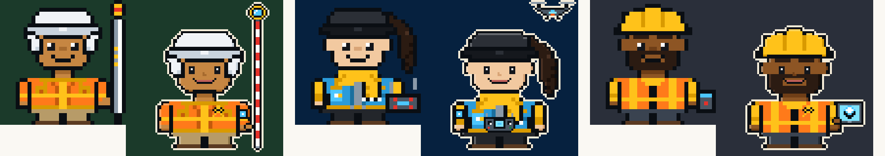

# Avatar en alta resolución · decisión

Pedido del dueño (2026-10-16): «darle más detalle a los pixel art del avatar; creo que no se entienden mucho con la
información; hacerlos con mayor resolución».

Complementa [`AVATAR_REDISENO.md`](AVATAR_REDISENO.md)
(aún en la rama `diseno-avatar`; plan G1–G7: escenario 40×40, escala entera, halo, `parts/gear/`). Aquí solo se decide **la
resolución de la figura** y cómo cambia ese plan (sección 4).

Maqueta generada con el motor real ([`tools/proto_avatar_hd.py`](../tools/proto_avatar_hd.py), prototipo):
[`img/avatar-res-comparacion.svg`](img/avatar-res-comparacion.svg) y vista rápida en PNG:



En cada par: izquierda **hoy** (`compose` 32×32), derecha **propuesta C** (capas ×2 + pase procedural + piezas HD de
muestra: ojos, nariz, boca, jalón con prisma, dron y control, tablet con cubo BIM, pin y parche de manga). Lo que se
lee mejor viene de las **piezas HD**, no del pase procedural: el pase da acabado (contorno de 1 px, luz, sombra, halo),
pero la ropa y el pelo de la maqueta siguen siendo bloques ×2. Por eso el plan dibuja en HD justo donde vive la
información.

---

## 0. Cómo es el motor hoy (medido)

| Dato | Valor | Dónde |
|---|---|---|
| Grilla | 32×32, filas ASCII `{y: "32 caracteres"}`, `sym()` espeja 16 | `avatar/art.py` |
| Catálogo | **23 grupos, 209 opciones** (`engine.CHOICES`) | `engine.py` |
| Piezas con forma (no color) | **108**: pelo 17 (frente + atrás), gorros 13 (frente + atrás), lentes 9, barba 8, ojos 5, cejas 5, boca 6, ropa 17, cuello 5, herramientas 13, pines 4, cuerpos 3, parte de abajo 3 | `parts/*.py` |
| Píxeles dibujados a mano | **≈ 7 500** (pelo 2 950, gorros 1 476, ropa 1 454, herramientas 708, lentes 378…) + cuerpo base 460 | medido |
| SVG por avatar | 4,2–8,5 KB (media 6,2) con dibujo de fondo; un `<path>` por color | `render_svg` |
| Tiempo de render | ≈ 0,7 ms | medido, 13 carreras |
| Orden de capas y reglas | pelo atrás → gorro atrás → cuerpo → ropa (solo sobre `O`) → cuello → barba → nariz → boca → ojos → cejas → lentes → pelo frente → gorro frente → pin → herramienta; ventana de cara `FACE_X 11..20 · FACE_Y 10..16` | `engine.compose` |
| Pruebas que fijan el arte | contrato por categoría (`validation.SPECS`), cada opción se ve distinta, cada color cambia el SVG, combinaciones pelo × gorro × lentes × barba, auditoría de choques | `tests/test_avatar_*.py` |

Por qué no se entiende: la cabeza tiene 12×12 de piel, un ojo es 2×2, una herramienta vive en una franja de 4–9 px
al costado (H6 de AVATAR_REDISENO), el pin es 4×4 y el marco es lo único que habla de nivel o rareza.

---

## 1. Opciones

| | **A · 64×64 nativo** (escenario 80×80) | **B · 48×48 nativo** (escenario 60×60) | **C · Híbrida 2× (recomendada)** |
|---|---|---|---|
| Qué es | Todo se redibuja a 64 | Todo se redibuja a 48 | Se compone el 32 de siempre **capa por capa ×2** en 64; cada opción puede tener **versión HD** que reemplaza su capa ×2; pase procedural de acabado; equipo e insignias en HD |
| Partes a dibujar | **108 + cuerpo**, todas, antes de poder publicar (≈ 30 000 px, 4× hoy) | 108 + cuerpo (≈ 17 000 px) | **≈ 70 piezas HD pequeñas en 6 tandas**, cada una opcional (sin HD se ve ×2); pelo, cuello y parte de abajo siguen ×2 |
| Relación con el 32 | Ninguna: dos juegos de arte que divergen | **1,5×: no entero**, no se puede reutilizar nada ni comparar | Exacta (×2): misma silueta, mismo orden de capas, mismas reglas ×2 |
| Peso SVG del avatar grande | ≈ 15–25 KB | ≈ 10–15 KB | **11–16 KB** (medido en la maqueta) |
| Render | ≈ 4× hoy | ≈ 2× hoy | **≈ 6 ms** en el prototipo sin optimizar (con caché, una vez por configuración) |
| Miniaturas del editor | Todas a 64: el HTML se multiplica | Escalas no enteras con las vistas de 16/24 | Las vistas chicas siguen en 32 (`head`, `bust`, `zone:*`); solo zonas con información usan HD |
| Determinismo | Igual (función de la config) | Igual | Igual: `compose_hd` es función pura de `clean_config(cfg)`; el pase es determinista |
| Configs guardadas | Mismas claves; todos los avatares cambian de golpe | Igual que A | Mismas claves e índices; cambian de aspecto solo las vistas grandes y pieza a pieza |
| Escala entera | 64 → 64/128/192; 80 → 80/160/240 | 60 → 120/180/240 | 80 → **80 / 160 / 240**; vistas chicas como en G3 |
| Pruebas | Se reescriben todos los contratos y la auditoría | Igual | Se suman (paridad HD↔32, registro HD ⊂ opciones); las de hoy siguen valiendo para el 32 |
| Aire pixel-art | Se pierde (D24 lo advirtió: «se pierde el aire») | Medio | Se mantiene: cabeza chibi, contorno, paleta |
| Riesgo | Alto: semanas de arte antes de ver algo | Alto | Bajo: cada tanda se publica sola y se puede volver atrás por pieza |

B queda descartada por la escala 1,5×. A da el mejor techo, pero paga dibujar pelo, ropa y cuerpo en 4× sin que eso
mejore la **información** (oficio, herramienta, cara, nivel), que es lo que pidió el dueño.

---

## 2. Recomendación: **C, figura de 64 en escenario HD de 80×80**

**Decisión de tamaño:** la figura grande pasa a **64×64 celdas** dentro de un **escenario de 80×80** (exactamente el
escenario 40×40 de AVATAR_REDISENO ×2: mismos carriles, aire y suelo). Tamaños válidos **80, 160 y 240 px**. Todo lo
que se ve a menos de 80 px (chip de cabecera, foro, notas, equipo, miniaturas) sigue en la grilla de 32 con las vistas
de G3 (`head` 16, `bust` 24, `zone:*`).

Por qué C:

1. Pone los píxeles **donde está la información**: cara, gorro, herramienta, pin y parche. El pelo y el cuerpo
   ganan acabado gratis con el pase.
2. **Cero riesgo para lo guardado:** no cambia ninguna clave ni índice; una pieza sin versión HD se ve ×2.
3. **Se entrega por tandas** (cada una mejora algo visible) y el 32 sigue sirviendo para tamaños chicos, donde una
   figura de 64 no se distinguiría igual.
4. Reusa casi todo G1–G7 (sección 4).

### 2.1 Arquitectura

```
clean_config(cfg)
  ├─ compose(cfg)        → 32×32  (igual que hoy)  → vistas full · bust · head · zone:*
  └─ compose_hd(cfg)     → 80×80
        por cada capa, en el mismo orden de compose():
            HD[categoría][opción] si existe, si no up2(pieza 32)       (reglas de cara y copa ×2)
        detail_pass()   contorno exterior 1 px · luz arriba-izq. · sombra abajo-der. · esquinas redondeadas
        gear HD (carril, aire, suelo) · manos de la pose · pin HD · insignias (parche, adhesivo)
        halo 1 px (clave 5)                                             → vista stage (80, 160, 240 px)
```

- Piezas HD como **sprites locales** con ancla, no filas de 64/80 caracteres:
  `{"at": (x, y), "rows": ["..KK..", ...]}` en coordenadas de la figura 64 (cara, gorro, ropa) o del escenario 80
  (equipo). Un validador revisa caja, claves y que no salgan de su zona.
- `detail_pass` probado en la maqueta: la mitad interior del contorno doble pasa a luz (arriba/izquierda) o sombra
  (abajo/derecha) del relleno vecino; líneas interiores (boca, ojos) no se tocan; esquinas exteriores de bloques 2×2 se
  recortan. Claves que solo pone el motor: `1` piel luz, `2` ropa luz, `3` gorro luz, `4` pantalón luz, `5` halo
  (las mismas de G4) y `k` línea interior.
- `functools.lru_cache(maxsize=512)` sobre `render_svg_hd(json.dumps(cfg, sort_keys=True), view)`.

### 2.2 Qué tiene que leerse (información) y presupuesto de píxeles

Coordenadas en la figura 64 (el escenario agrega 8 a x y 12 a y). Medidas a 2× = 160 px salvo que se diga.

| Zona | Celdas HD | Hoy (32) | Qué debe leerse | Quién lo hace |
|---|---|---|---|---|
| Cabeza (piel) | 24×24 (x 20..43 · y 10..33) | 12×12 | Forma de cara, orejas, tono | ×2 + pase |
| Ventana de cara | 20×14 (x 22..41 · y 20..33) | 10×7 | **Ojos** 3×4 c/u con brillo y párpado; **cejas** 5×2; nariz 2×2; **boca** hasta 10×3 con labio | HD (`hd/face.py`) |
| Lentes | 2 lentes 7×5 + puente 2×1 | 4×3 | Tipo (redondos, seguridad, sol, FPV) por forma y brillo | HD |
| Barba | banda 20×8 (y 28..35) | 10×4 | Tipo por textura (2 tonos) sin tapar la boca | HD |
| Gorro / casco | 30×14 (x 17..46 · y 2..15) + visera | 15×7 | Casco de obra con ala y **adhesivo de insignia 4×4**; gorra, legionario, hélice, audífonos | HD (`hd/headwear.py`) |
| Pelo | 32×30 | 16×15 | Volumen y color | ×2 + pase (HD en fase 2 si el dueño lo pide) |
| Torso / ropa | 32×16 (x 16..47 · y 40..55) | 16×8 | Por disciplina: franjas reflectantes 2 px, bolsillos 4×4, cierre, solapa, logo de chaleco | HD como **detalle sobre `O`** (no cambia silueta) |
| Pin de nivel | **6×6** (x 38..43 · y 42..47) | 4×4 | Brújula, casquito, teodolito (NV 5, NV 10) | HD (`hd/badges.py`) |
| Parche de manga | **5×5** en la manga (x 10..14 · y 44..48) | — | Color de la insignia de mayor rareza ganada | Procedural |
| Manos | 4×4 c/u, según pose | 2×1 | Que tomen la herramienta | HD (`hd/hands.py`) |
| Piernas y botas | 16×6 + 16×2 | 8×3 + 8×1 | Pantalón, short, falda | ×2 + pase |
| Carril derecho (equipo) | 24×76 (escenario x 56..79) | 8×32 | **Herramienta de mano ≥ 12×12** (tablet, laptop, calculadora, taza, llave); **alta ≥ 4×60** (jalón, mira, rover); prisma ≥ 10×9 | HD (`parts/gear/`) |
| Aire | 24×12 (y 0..11) | — | Dron ≥ 22×9 | HD |
| Suelo | 30×12 (y 66..79) | — | Estación total en trípode ≥ 14×24 (cabezal 10×8), cono 10×12 | HD |
| Nivel y rareza | — | marco 1 px en el SVG | Marco CSS 4 px con color de rareza + placa «NV n» | HTML/CSS (G3), fuera del SVG |

Silueta por carrera (se reconoce sin leer): **topografía** = jalón alto o estación al pie + chaqueta con franjas;
**captura** = dron en el aire + control con dos palancas; **civil** = casco amarillo + chaleco reflectante + tablet o
cono; **arquitectura/BIM** = blazer o polerón + laptop con cubo; **mecánica** = overol + llave o volante de válvula;
**transversal** = credencial + tablilla. Prueba: en la hoja `--sheet class view=stage` a 2× sobre oscuro y papel,
Haiku anota qué carrera no se distingue.

Insignias en el avatar (3–4 accesorios): pin de nivel (existe), adhesivo del casco (insignia de obra), parche de manga
(rareza más alta), marco (rareza, existe). Ninguno muestra texto ni datos de credenciales.

---

## 3. Plan de migración (Sonnet 5.5 medio, `bloque-dev`; arte con `artista-pixel`)

Rama base: la de G (`diseno-avatar`) ya con G1–G3 fusionados. PR apilados `avatar-hd-<n>-<tema>`. Commits en
español; `uv run pytest` y `ruff` en cada paso; `revision-privacidad` antes de publicar.

### HD-1 · Motor (sin arte nuevo)

- `avatar/hd/__init__.py`: `GRID_HD = 64`, `STAGE = 80`, `OFFSET = (8, 12)`, `up2(rows)`, registro
  `HD = {categoría: {opción: sprite}}`, `sprite(at, rows)`.
- `avatar/hd/compose.py`: `compose_hd(cfg)` con el mismo orden y reglas que `compose` (`FACE_X/Y`, `_hat_top`,
  `_off_face` ×2; ropa solo sobre `O`).
- `avatar/hd/detail.py`: `detail_pass`, `halo` (de G4, aquí en 80), suelo.
- `engine.render_svg(view="stage")` → 80×80; `palette_for` suma `1..5`, `k` con `_lighten`.
- `tools/preview_avatar.py --hd` y `tools/validate_part.py hd:<categoría>`; se retira `tools/proto_avatar_hd.py`.
- **Pruebas:** `test_stage_hd_is_80_and_deterministic`, `test_every_option_renders_in_hd` (las 209),
  `test_hd_without_art_equals_up2_plus_pass` (sin piezas HD el resultado es el 32 ×2 + pase),
  `test_face_window_is_sacred_in_hd`, `test_parts_never_use_engine_keys` (`1..5` solo del motor),
  `test_choices_are_append_only` (instantánea ordenada de cada lista de `CHOICES`: solo se agrega al final),
  `test_hd_render_budget` (< 16 KB por SVG, < 20 ms).

### HD-2 a HD-7 · Arte por tandas (`artista-pixel`, una tanda por PR, ≤ 5 piezas por commit)

| Tanda | Archivo | Piezas (caja máx. en celdas HD) | Px aprox. |
|---|---|---|---|
| HD-2 Cara | `hd/face.py` | ojos ×5 (2 de 4×4), cejas ×5 (5×2), boca ×6 (10×4), nariz ×1 (2×2) | ≈ 350 |
| HD-3 Lentes y barba | `hd/glasses.py`, `hd/facial_hair.py` | lentes ×8 + `none` (20×6), barba ×7 + `none` (20×8) | ≈ 1 400 |
| HD-4 Equipo topografía y captura | `parts/gear/survey.py`, `parts/gear/capture.py` (coords del escenario 80) | jalón, rover GNSS, estación total, mira; control + dron, escáner en trípode, cámara | ≈ 2 200 |
| HD-5 Equipo obra, BIM, IA y planta | `parts/gear/build.py`, `ai.py`, `plant.py` | tablet, laptop BIM, rollo de planos, escalímetro, tablilla, calculadora, cono, taza; laptop IA; llave, cañería, volante | ≈ 2 600 |
| HD-6 Gorros | `hd/headwear.py` | 12 gorros + `none` (30×14 frente, atrás si aplica) con ranura de adhesivo | ≈ 3 000 |
| HD-7 Ropa, pines, manos | `hd/outfits.py`, `hd/badges.py`, `hd/hands.py` | detalle de 17 ropas sobre `O` (32×16); 3 pines (6×6); manos por pose (4×4) | ≈ 3 500 |

Contrato para cada artista: sprite con ancla en su zona, contorno `K`, interior `k`, ≤ 3 tonos por zona, claves de la
paleta (sin `1..5`), «se reconoce sin leer el nombre» a 160 px sobre `#0F2A4D` y `#FAF8F3`; misma silueta que la pieza
32 (prueba de paridad). Validar con `validate_part.py hd:<cat>` y `preview_avatar.py --hd --sheet <cat> scale=3`.

**Sigue procedural:** escalado ×2 de pelo, cuello, cuerpo y parte de abajo; contorno, luz, sombra, halo y suelo;
parche de manga (color de rareza); adhesivo del casco (color de la insignia); fondos (dibujo de `backgrounds.py` ×2.5
en el escenario, con máscara de halo).

**Opciones e índices:** el registro HD solo acepta ids que ya están en `CHOICES` (`test_hd_ids_are_known_options`);
nada nuevo se elige por HD. Ids nuevos de equipo (G6) se agregan **al final** de `PROPS` con su versión 32 (aunque sea
mínima) para que el 32 no quede en blanco. Paridad: la máscara HD reducida ×2 coincide con la máscara 32 en ≥ 70 %
(`test_hd_matches_low_silhouette`), así miniatura y vista grande cuentan lo mismo.

**Rendimiento de `/perfil/avatar/`:** 1 SVG HD de vista previa (≈ 16 KB); miniaturas con información en HD solo
como **zonas a 1×–2×** (ojos 24×12 a 2× = 48×24; herramienta 24×48 a 1×; gorro 24×24 a 2× = 48); el resto con las
vistas 32 de G3. Meta: **HTML ≤ 160 KB sin comprimir (≤ 30 KB gzip), ≤ 110 `<svg>`**, render del servidor ≤ 80 ms
para la página (caché por configuración). Si se pasa, las miniaturas de piezas pasan a `` cacheable con paleta
neutra (decisión en HD-7).

**Qué verifica Haiku (`verificador`) en cada tanda:** CI local verde; `audit_avatar.py` y `validate_part.py hd:<cat>`
sin avisos; peso y número de `<svg>` del editor; hoja de contactos de la tanda a 160 px en oscuro y papel (anota piezas
que no se reconocen); zoom 400 % sin bandas (escala entera); `stage` a 80 px sigue legible.

**Esfuerzo:** HD-1 ≈ 1 sesión Sonnet; 6 tandas de arte ≈ 6 sesiones `artista-pixel` (paralelizables de a 2–3 por
archivos distintos) + 1 revisión Opus por tanda; total ≈ 8–9 sesiones Sonnet. La opción A serían ≈ 20+ sesiones de
arte antes del primer PR útil.

---

## 4. Impacto en el plan G1–G7 de AVATAR_REDISENO

| PR | Qué pasa |
|---|---|
| G1 editor | **Sin cambios.** Acordeón, miniaturas por zona, acciones |
| G2 hoja | **Sin cambios.** Avatar del héroe: `stage` a 2× = **160 px** (en vez de 40 a 4×) |
| G3 escala | **Se reusa** (marco fuera del SVG, `svg_sized`, vistas `head`/`bust`/`zone:*`). Cambia: `stage` válido en múltiplos de **80**; editor 240 (3×), 375 px: 160 |
| G4 silueta | Halo, claves `1..5`/`k`, `_lighten`, fondos claros y `FIXED` **se reusan**; luz y sombra de borde pasan al `detail_pass` HD. En 32 solo halo |
| G5 escenario | **Cambia:** el escenario se construye en **80×80** (carriles ×2: derecho x 56..79, izquierdo 0..23, aire y 0..11, suelo 66..79). Se hace junto con HD-1. Poses: manos HD; los parches de brazo 32 se mantienen |
| G6 equipo | **Cambia:** `parts/gear/` se dibuja en coordenadas del escenario 80 (HD-4 y HD-5 lo reemplazan); `shift_legacy` pasa a `up2` + desplazamiento |
| G7 docs | Sumar esta decisión (D nueva: «figura HD 64 en escenario 80, híbrida sobre el 32») y actualizar `AVATARES_PIXEL.md` |

Para quien implementa G hoy: G1–G4 siguen tal cual; **no empezar G5/G6 en 40×40**: pasar directo a HD-1.

---

## 5. Preguntas para el dueño (con recomendación)

| # | Pregunta | Tipo | Recomendación |
|---|---|---|---|
| R1 | ¿Se aprueba la opción C (figura grande 64 en escenario 80; tamaños chicos siguen en 32)? | Producto | Sí |
| R2 | ¿El pelo también se redibuja en HD (fase 2, 17 peinados × 2 capas ≈ 4 sesiones)? | Producto | Solo si tras HD-7 se sigue viendo «en bloques» |
| R3 | ¿El avatar muestra insignias (adhesivo del casco, parche de manga)? Las ven todas las personas aprobadas | Privacidad | Sí, solo insignias que ya son públicas en la vitrina; nada de credenciales. Agregar al final la clave `show_badges` (sí por defecto) para quien prefiera ocultarlas |
| R4 | ¿El nivel va dentro del dibujo (estrellas en el casco) o solo en la placa «NV n»? | Producto | Solo placa: el SVG sigue siendo función de la configuración |
| R5 | ¿La herramienta de la carrera aparece siempre aunque se elija «Sin herramienta»? | Producto | No; la carrera la propone por defecto y la persona decide |
| R6 | ¿Se acepta que todos los avatares guardados se vean distintos en las vistas grandes (la configuración no cambia)? | Producto | Sí, igual que Q1 de AVATAR_REDISENO |
